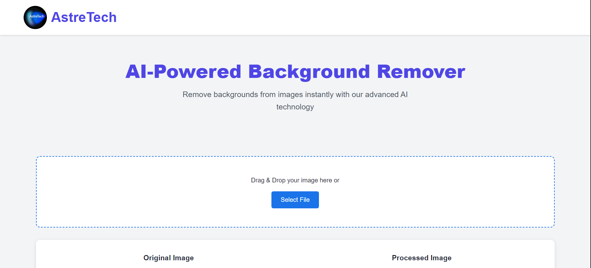

<div align="center">

# 🔮 AstreTech AI Background Remover

### ✨ AI-Powered Image Background Removal

**Remove backgrounds. Transform images. Unleash creativity.**

A modern, responsive web application that simplifies image background removal using AI-powered image processing.

<br>


<br>

[](https://github.com/YashGunjal9/AI-Powered-Background-Remover)
[](https://developer.mozilla.org/en-US/docs/Web/JavaScript)
[](https://developer.mozilla.org/en-US/docs/Web/HTML)
[](https://developer.mozilla.org/en-US/docs/Web/CSS)
[](https://www.slazzer.com/api/)

<br>

[Features](#-features) •
[Screenshots](#-project-screenshots) •
[Technologies](#-technologies-used) •
[Installation](#-installation) •
[Workflow](#-how-it-works) •
[Contributing](#-contributing)

</div>

---

## 📸 Project Screenshots

### 🖥️ 1. Dashboard

The AstreTech homepage features a clean interface, image upload area, and original-versus-processed image preview.

<p align="center">
  
</p>

### 🖼️ 2. AI Background Removal — Before & After

Compare the original image with the AI-processed image after its background has been removed.

<p align="center">
  
</p>

### ✨ 3. Features and Social Media Links

Explore the feature cards, including Lightning Fast, AI Powered, and Secure, followed by the website footer with quick links and social media icons.

<p align="center">
  
</p>

---

## ✨ Features

<table>
<tr>
<td width="50%">

### 🖼️ Image Upload

Select images from your device or drag and drop them into the upload area.

</td>
<td width="50%">

### 🤖 AI Background Removal

Remove image backgrounds using the configured Slazzer API.

</td>
</tr>
<tr>
<td width="50%">

### 🔍 Before & After Preview

View the original and processed images side by side.

</td>
<td width="50%">

### ⬇️ Download Results

Download the processed image to your device.

</td>
</tr>
<tr>
<td width="50%">

### 📱 Responsive Interface

Use a flexible interface designed for different screen sizes.

</td>
<td width="50%">

### ⚡ Interactive Experience

Enjoy drag-and-drop functionality, image previews, and processing indicators.

</td>
</tr>
</table>

---

## 🛠️ Technologies Used

<div align="center">

| Technology         | Purpose                                 |
| ------------------ | --------------------------------------- |
| HTML5              | Website structure                       |
| CSS3               | Styling, layouts, and responsive design |
| JavaScript         | Application logic and API integration   |
| Font Awesome       | Icons and visual elements               |
| Slazzer API        | AI-powered background removal           |
| Visual Studio Code | Development environment                 |
| Git & GitHub       | Version control and project hosting     |

</div>

---

## ⚙️ How It Works

```text
       ┌─────────────────────────┐
       │      Select Image       │
       └────────────┬────────────┘
                    │
                    ▼
       ┌─────────────────────────┐
       │    Preview Original     │
       └────────────┬────────────┘
                    │
                    ▼
       ┌─────────────────────────┐
       │   Remove Background     │
       └────────────┬────────────┘
                    │
                    ▼
       ┌─────────────────────────┐
       │       Slazzer API       │
       │   AI Image Processing   │
       └────────────┬────────────┘
                    │
                    ▼
       ┌─────────────────────────┐
       │   Preview Processed     │
       │         Image           │
       └────────────┬────────────┘
                    │
                    ▼
       ┌─────────────────────────┐
       │     Download Result     │
       └─────────────────────────┘
```

### Processing Workflow

1. Select an image from your device.
2. Preview the original image.
3. Click **Remove Background**.
4. The application sends the image to the configured Slazzer API.
5. View the processed image.
6. Click **Download Result** to save the output.

---

## 🚀 Installation

### Prerequisites

* A modern web browser.
* Visual Studio Code or another code editor.
* A valid Slazzer API key for background processing.

### 1. Clone the Repository

```bash
git clone https://github.com/YashGunjal9/AI-Powered-Background-Remover.git
```

### 2. Open the Project

```bash
cd AI-Powered-Background-Remover
```

### 3. Launch the Application

1. Open the project folder in Visual Studio Code.
2. Install the **Live Server** extension if necessary.
3. Right-click `index.html`.
4. Select **Open with Live Server**.

### 4. Configure API Access

Configure the Slazzer API integration according to the provider's current documentation.

**Security recommendation:** For production deployment, route API requests through a backend and store your API key in server-side environment variables. Never publish API credentials in frontend JavaScript or commit them to GitHub.

---

## 📂 Project Structure

```text
AI-Powered-Background-Remover/
│
├── Screenshots/
│   ├── Dashboard.png
│   ├── Image conversion.png
│   └── Social Media Links.png
│
├── AstreTech Black BG PNG Rounded Logo.png
├── index.html
├── styles.css
├── script.js
└── README.md
```

---

## 🔐 Security & Privacy

* Keep API credentials out of public repositories.
* Validate uploaded image types and file sizes.
* Handle failed API requests gracefully.
* Hide loading indicators when processing completes or fails.
* Follow the API provider's image-handling and privacy requirements.

---

## 🗺️ Future Improvements

* [x] Image upload interface
* [x] Drag-and-drop support
* [x] Original and processed image previews
* [x] Download controls
* [x] Responsive interface
* [x] Slazzer API integration
* [ ] Secure backend API integration
* [ ] Improved error handling
* [ ] Image format and file-size validation
* [ ] Processing history
* [ ] Additional image editing options

*Update this checklist as features are implemented and verified.*

---

## 🤝 Contributing

Contributions, suggestions, and improvements are welcome!

1. Fork this repository.

2. Create a feature branch:

   ```bash
   git checkout -b feature/your-feature
   ```

3. Commit your changes:

   ```bash
   git commit -m "Add your feature"
   ```

4. Push your branch:

   ```bash
   git push origin feature/your-feature
   ```

5. Open a Pull Request.

---

## 👨‍💻 Author

<div align="center">

### Yash Gunjal

Computer Engineering Student | Web Development Enthusiast

[](https://github.com/YashGunjal9)

</div>

---

## 📄 License

No license has been specified for this project yet.

If you want others to reuse, modify, and distribute your code, choose an appropriate open-source license and add its text to a `LICENSE` file.

---

<div align="center">

### 🔮 AstreTech

**Empowering creativity through AI innovation.**

Made with ❤️ by Yash Gunjal

</div>
